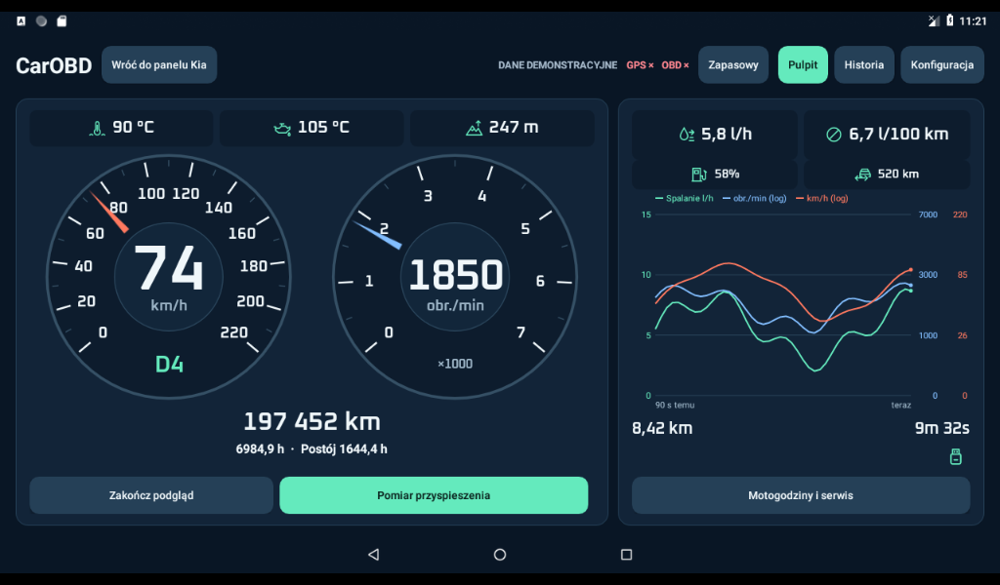
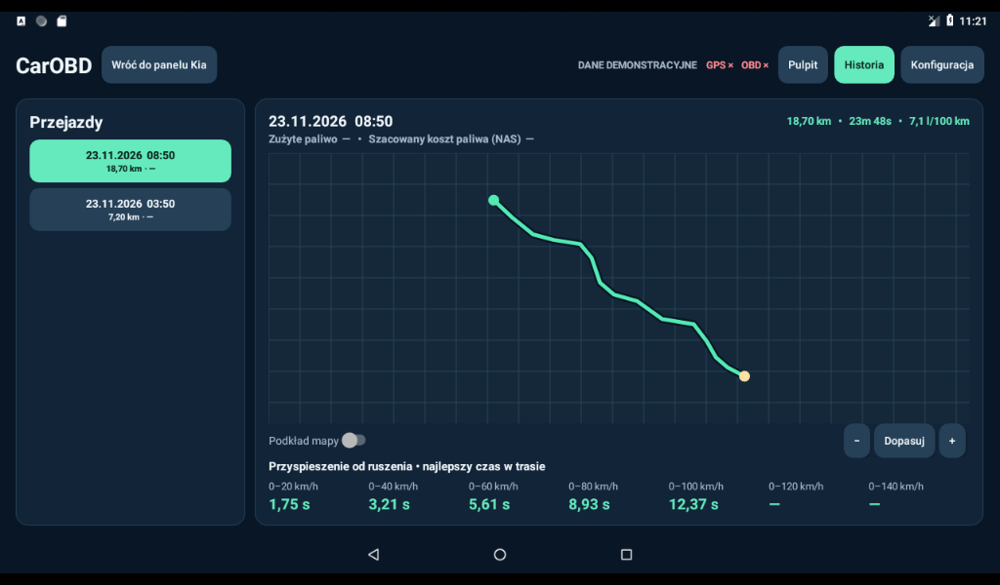

# CarOBD dla Androida i RadioKIA Pulpit

Zestaw aplikacji na samochodowe stacje multimedialne z Androidem. CarOBD odczytuje dane z adaptera ELM327 i korzysta z GPS radia. RadioKIA Pulpit łączy ekran główny, telemetrię i tuner FM.

## Aplikacje

| Moduł | Funkcje |
| --- | --- |
| [CarOBD](android-radio) | Prędkość, obroty, wysokość GPS, temperatury, spalanie, odczyt błędów OBD i historia przejazdów z mapą. Lokalne kopie GPX na SD, USB lub w pamięci radia. Profile adapterów BLE, Bluetooth Classic i Wi-Fi. |
| [RadioKIA Pulpit](launcher-preview) | Ekran główny Androida z regulowanym podziałem paneli, danymi CarOBD, mapą, tunerem oraz skrótami do aplikacji. Przesuń w lewo, aby przejść z Układu do FM, a potem do CarOBD. Przesuń w prawo, aby wrócić. Z karty CarOBD można otworzyć pełne zegary i historię. |
| [RadioKIA FM](fm-offline) | Samodzielny tuner ze skalą FM, ośmioma presetami, wyszukiwaniem stacji oraz RDS, gdy jednostka udostępnia dane. Sterowanie zależy od zgodności sprzętowej z usługą Topway XTService. |

W pełnym RadioKIA FM i na widocznym panelu FM Pulpitu na zgodnym TS7 krótkie naciśnięcie przycisku na kierownicy przechodzi do następnego lub poprzedniego presetu. Długie uruchamia wyszukiwanie stacji w tunerze.

Przycisk **Wideo · VLC** w górnym pasku Pulpitu otwiera VLC. Przy pierwszym użyciu pokazuje ustawienia obrazu w obrazie (PiP). Po uruchomieniu filmu użyj przycisku Home lub trybu podręcznego VLC. Dostępność małego okna zależy od wersji VLC i obsługi PiP na radiu.

## Przykładowe ekrany

Zrzuty pokazują dane demonstracyjne wygenerowane przez aplikację na emulatorze.





## Budowanie i uruchomienie

Potrzebne są Python 3, JDK 17 lub nowszy i Android SDK z platformą `android-34` oraz Build Tools `35.0.0`. Ustaw `ANDROID_HOME` albo przekaż ścieżkę przez `--sdk`.

```sh
python android-radio/build.py
python fm-offline/build.py
python launcher-preview/build.py
```

Każdy moduł zapisuje podpisany APK we własnym katalogu `dist/`. Skrypty domyślnie korzystają ze wspólnego, lokalnie generowanego klucza w `private/`. Wspólny podpis umożliwia Pulpitowi odczyt bieżącej telemetrii i presetów. Zachowaj swój klucz do budowania kolejnych aktualizacji.

Zainstaluj APK na Androidzie 8.1 (API 27) lub nowszym. W CarOBD wybierz adapter i nadaj aplikacji wymagane uprawnienia Bluetooth oraz lokalizacji. Widoki można obejrzeć bez samochodu przez **Konfiguracja → Podgląd demonstracyjny**.

Aby pod przyciskiem Home otwierał się RadioKIA Pulpit, wybierz go w **Ustawienia Androida → Aplikacje → Aplikacje domyślne → Ekran główny**. Dostęp do tego wyboru jest też w menu **Aplikacje → Ekran główny** w Pulpicie. W tym samym miejscu można przywrócić wcześniejszy ekran główny.

## Fabryczny ekran główny i gesty

Aby zachować fabryczny ekran jako pierwszą stronę, w Pulpicie otwórz **Aplikacje → Gesty motywu**. Wybierz launcher producenta w ustawieniach ekranu głównego i włącz **RadioKIA – gesty motywu** w Ułatwieniach dostępu. Przeciągnij uchwyt u dołu w lewo, żeby przejść z Home do pełnego RadioKIA FM, a następnie do pełnego CarOBD. Gest w prawo wraca. Uchwyt pojawia się na tych trzech ekranach. Do przełączeń potrzebne są zainstalowane aplikacje FM i CarOBD. Aby wyłączyć gesty, wyłącz usługę w ustawieniach Androida. Po włączeniu usługi Pulpit na Androidzie 8.1 wznawia rejestrator CarOBD także po wybudzeniu ekranu. Autostart wymaga nadanego uprawnienia do dokładnej lokalizacji w CarOBD.

## Rejestracja i synchronizacja

- **Rejestruj przejazdy** uruchamia automatyczny zapis po ruszeniu. Wyłączenie kończy bieżący zapis. Odczyty GPS i OBD nadal działają.
- **Wysyłaj przejazdy do NAS** steruje wysyłką zakończonych przejazdów. Przy wyłączonej wysyłce kolejka czeka lokalnie, a pobieranie historii z własnego NAS nadal jest możliwe. Synchronizacja wymaga zgodnego serwera i danych dostępu urządzenia.

Publiczny projekt jest gotowy do rejestracji lokalnej. Integracja z własnym NAS wymaga obsługi protokołu z `Maintenance.java` i `NasHistory.java`, ustawienia adresu w `Settings.java` i zarejestrowania klienta przez `ProvisionNas.java`. Serwer NAS i dane dostępowe nie są częścią repozytorium.

Dostępność PID, danych RDS i sterowania FM zależy od pojazdu, adaptera i stacji multimedialnej. Rozszerzone odczyty oraz ustawienia serwisowe specyficzne dla Kia wymagają dopasowania do zweryfikowanego pojazdu.

Krój Oxanium używany w CarOBD jest dołączony z licencją [SIL Open Font License](android-radio/res/raw/oxanium_ofl.txt).
